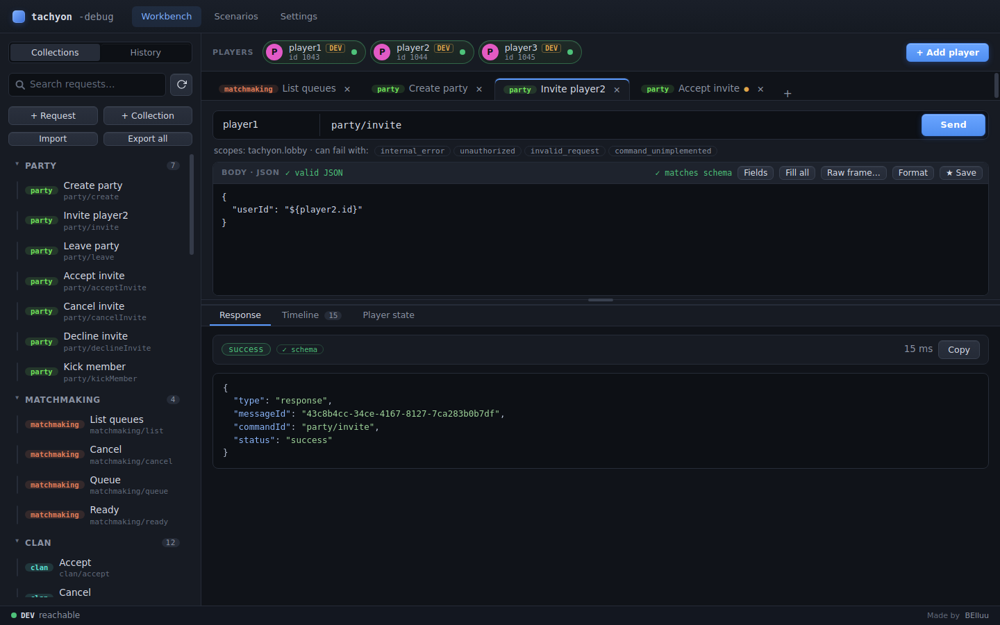
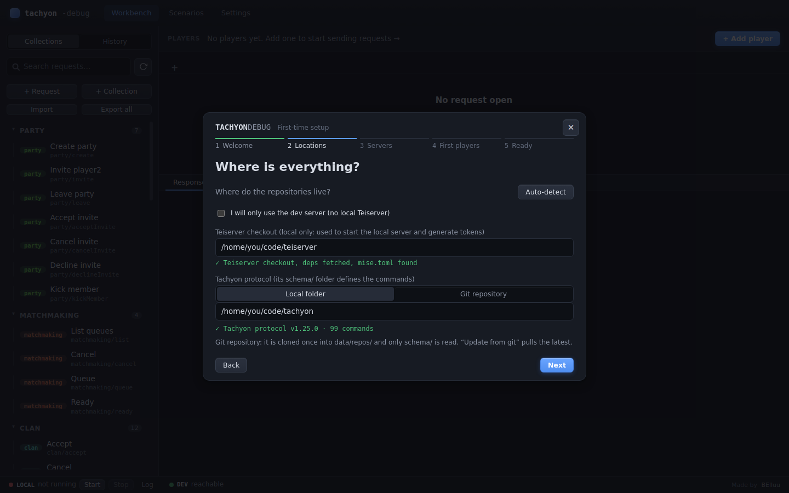
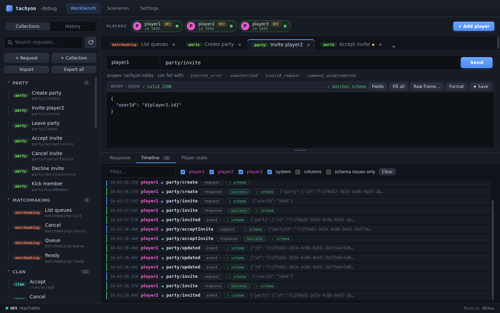
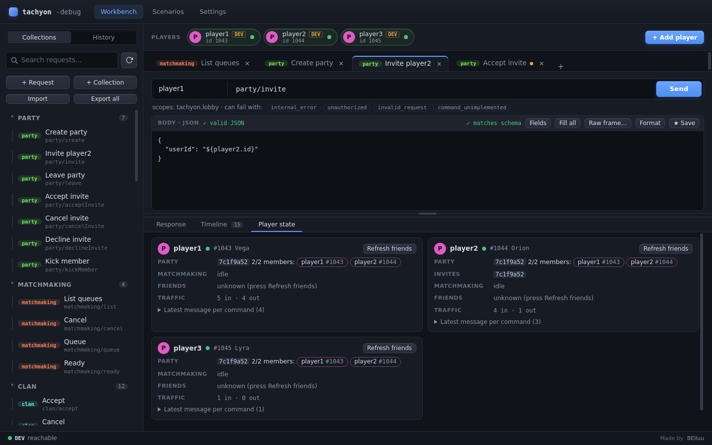
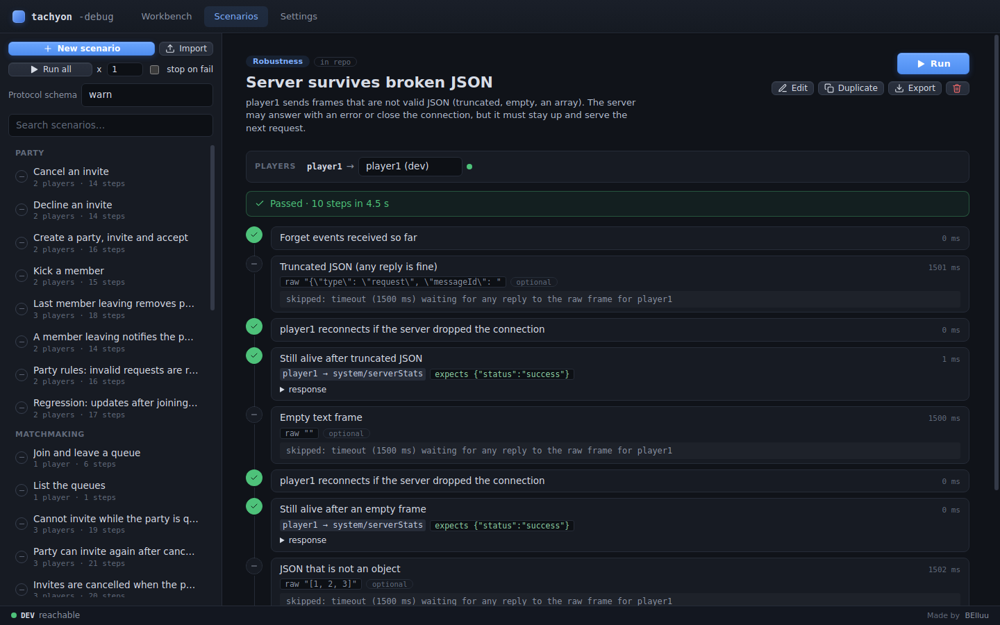

# TachyonDebug

A workbench for poking a [Teiserver](https://github.com/beyond-all-reason/teiserver) **Tachyon** server with several players at once: send requests, watch every message, validate it against the protocol schema, replay multi-player flows as scenarios.



## Run it

You need **Node.js 18+**, a browser, and the [Tachyon protocol](https://github.com/beyond-all-reason/tachyon) (a local checkout or just its git URL). A Teiserver checkout is only needed for a local server; the dev server works without it.

```bash
git clone git@github.com:BElluu/TachyonDebug.git
cd TachyonDebug
npm install
npm start          # http://localhost:2137  (PORT=3000 npm start for another port)
```

The first run opens a setup wizard (locations, servers, first players). Close it any time with **✕** or **Esc**; everything stays in **Settings**.



## Features

- **Players**: connect as many users as you like, to a local Teiserver (tokens generated for you) or the dev server (browser login). Sessions are named `player1`, `player2`, …
- **Collections** of saved requests, filled automatically with a template for every protocol command. `${player2.id}` in a body resolves to that player's user id. `Ctrl+Enter` sends, `Ctrl+S` saves, `/` jumps to the command box.
- **Schema validation**: the body is checked live, **Fields** lists what a command accepts, and every message gets a `✓ schema` / `⚠ schema` badge.
- **Timeline** of every message of every player, with filters, resend and save-as-request.



- **Player state**: each player's party, invites, matchmaking and friends, derived from events.



- **Bad input and flaky connections**: kill or reconnect a player, send raw frames (broken JSON, missing fields, 1 MB payloads, …), probe auth with invalid tokens.

## Scenarios

Scripted multi-player flows with assertions. Pick a scenario, choose which of your sessions plays each role, press **Run**. **Run all** skips scenarios without assigned players; failures show what the server actually answered.



Scenarios are plain JSON files: `scenarios/*.json` belongs to the repo (commit yours to share them; `npm test` validates them), `data/scenarios/` is local and git-ignored. Format and step reference: the header of `src/scenarios.js`.

```json
{ "name": "Invite and accept", "category": "Party", "sessions": ["player1", "player2"],
  "steps": [
    { "as": "player1", "command": "party/create", "capture": { "party": "data.party" } },
    { "as": "player1", "command": "party/invite", "data": { "userId": "${player2.id}" }, "expect": { "status": "success" } },
    { "as": "player2", "waitFor": "party/invited" },
    { "as": "player2", "command": "party/acceptInvite", "data": { "partyId": "${party.id}" } }
  ] }
```

### CLI / CI

```bash
npm run scenarios -- --list
npm run scenarios -- --category Party --schema fail --junit report.xml
```

Exit code `0` all passed, `1` a failure, `2` setup problem. See `--help` for more.

## Configuration

Everything is editable in Settings and stored in `data/` (git-ignored; tokens never reach the browser). Environment variables: `PORT` (2137), `TEISERVER_DIR`, `TACHYON_DIR`, `TACHYON_URL`, `TACHYON_DEV_URL`, `TACHYON_CLIENT_ID`, `TACHYON_DEBUG_DATA`.

## Tests

```bash
npm test
```

## License

[MIT](LICENSE) © Bartłomiej Komendarczuk
